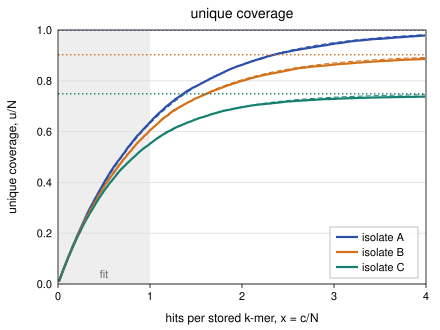
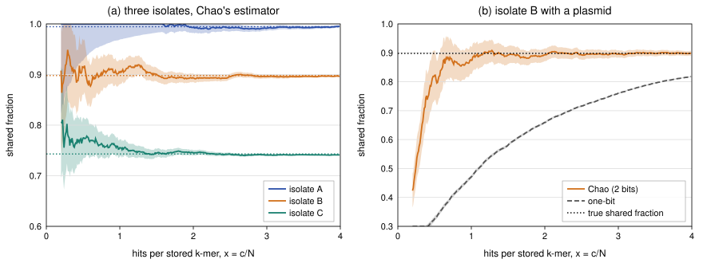

# Shared fraction and evolutionary distance

When Genestrip matches the reads of an isolate, it can estimate for every tax id of rank species or
below how much of that tax id's *k*-mers the isolate shares, and from that an evolutionary distance.
The results appear in the match CSV file as the columns `shared fraction`, `missing kmers` and
`evo distance`, each with a confidence interval (see [CSVColumns.md](CSVColumns.md)). This page
explains how they are computed and what they mean.

## What is estimated

A Genestrip database stores each *k*-mer with the lowest common ancestor of the genomes that contain
it. For a tax id $`t`$ let $`N`$ be the number of *k*-mers stored with $`t`$ (column `db kmers`), and
$`M`$ the number of those that also occur in the isolate's genome. The **shared fraction** is

```math
\pi = M / N .
```

The observed share $`u/N`$ (column `unique kmers` divided by `db kmers`) understates $`\pi`$ as long
as the reads are too few to hit every shared *k*-mer. The estimates below correct for that.

$`\hat D = (1 - \hat\pi) N`$ (column `missing kmers`) estimates how many of $`t`$'s *k*-mers the isolate
lacks. It is a lower bound for the *k*-mers in which isolate and genome differ:

- *k*-mers the isolate has gained are invisible, since only hits on stored *k*-mers are counted;
- *k*-mers stored with ancestors of $`t`$, those the genome shares with other tax ids, can be missing
  from the isolate too, but are not counted.

For the same reason, $`\pi`$ is a share of $`t`$'s own *k*-mers, the variable part of its genomes, not
of the whole genome.

## The model

Let $`c`$ be the number of read *k*-mers that hit $`t`$ (column `kmers`) and $`u`$ the number of
distinct ones (column `unique kmers`). Each shared *k*-mer is hit once by every read that covers it,
and the number of such reads is Poisson-distributed (Lander and Waterman's coverage model [4]). The hits on
a shared *k*-mer are therefore Poisson with mean $`\lambda = c/M`$, and

```math
\mathrm{E}[u] = M \left(1 - e^{-c/M}\right).
```

This is the model of sylph [1]; for $`\pi = 1`$ it is Genestrip's column `exp. unique kmers`. Random
sequencing errors only remove hits, since a *k*-mer with an error rarely matches a stored one. As
$`c`$ counts hits and not reads, the model needs no error term.



**Figure 1.** Unique coverage $`u/N`$ of three simulated isolates against one database node with
$`N = 600{,}797`$ stored *k*-mers ($`k = 31`$, reads of 150 bases). The isolates share $`\pi = 0.994`$,
$`0.898`$ and $`0.743`$ of the node's *k*-mers. Solid: the observed curve. Dashed: the model with $`\hat\pi`$ of the
one-bit estimator (below) at $`x = 1`$, the end of the shaded part; dotted: its asymptote
$`\hat\pi = 1`$, $`0.903`$ and $`0.749`$. At that point the curves have reached only $`u/N = 0.63`$,
$`0.60`$ and $`0.55`$.

## Two estimators

The configuration value `kmerHitCounterBits` decides how hits are recorded and so which estimator is
used.

**`kmerHitCounterBits=1`** (default). Each stored *k*-mer has one bit that marks it as hit. Only
$`u`$ and $`c`$ are known, and $`\hat\pi`$ solves

```math
\frac{u}{N} = \hat\pi \left(1 - e^{-c/(\hat\pi N)}\right),
```

capped at one. The right-hand side increases in $`\hat\pi`$, so there is exactly one solution once some
*k*-mer was hit twice ($`u < c`$). Before that, nothing is known but that $`\pi`$ lies between
$`u/N`$ and one: `shared fraction` stays empty and only the interval is given.

**`kmerHitCounterBits=2`**. Each stored *k*-mer has a counter that stops at three. It yields the
numbers $`f_1`$ and $`f_2`$ of *k*-mers hit exactly once and exactly twice (columns `kmers hit once`,
`kmers hit twice`), and $`M`$ is estimated by Chao's estimator [2] in its bias-corrected form:

```math
\hat M = u + \frac{f_1 (f_1 - 1)}{2 (f_2 + 1)}, \qquad \hat\pi = \min(1, \hat M / N).
```

Under equal rates the two estimate the same. They differ when some shared *k*-mers are hit more often
than others (see [Sources of error](#sources-of-error)). Both then understate $`\pi`$, but Chao's
estimator less, and since it does not use $`c`$, a few *k*-mers hit very often, such as those of a
multi-copy plasmid, do not move it. In simulations, a plasmid holding 5 % of the shared *k*-mers at 20
copies made the first estimator miss by more than 0.3 at one hit per stored *k*-mer, while Chao's
estimator stayed within the scatter of uniform coverage.

Where the counter lives: the second bit is taken from the database entry, as long as the database holds
at most half the values (tax ids) its layout allows, 131,072 at `radixStoreBits=17`. A database with
more values, and a run with `parallelDbMatching=true`, keep the counters in a vector of their own at two
bits per stored *k*-mer.

## Confidence intervals

The *k*-mers of one read are hit together: a read of length $`L`$ puts up to $`L - k + 1`$ hits on
neighbouring *k*-mers. The hits are therefore not independent, and variances derived for independent
draws are far too small, by a factor of about $`b`$, the mean length of the run a hit belongs to,

```math
b = \frac{\mathrm{E}[B^2]}{\mathrm{E}[B]} ,
```

where $`B`$ is the number of hits in a run. Genestrip takes $`b`$ from its per-tax-id counters of runs
of consecutive hits (`contigs`, the sum of their lengths and of their squared lengths). sylph avoids the
dependence by sampling only every 200th *k*-mer [1]; Genestrip counts every *k*-mer and accounts for it
instead.

For **Chao's estimator**, $`u`$ is observed and only the number of unhit shared *k*-mers,
$`\hat f_0 = \hat M - u`$, is estimated. With $`\hat\lambda = 2 f_2 / f_1`$,

```math
\mathrm{Var}(\hat f_0) \approx \frac{f_1}{\lambda} \sum_{j=-(b-1)}^{b-1} \varphi\!\left(\frac{|j|}{b}\right),
\qquad
\varphi(s) = e^{-\lambda s} (1-s)^2 \left((1-s)^2 + \frac{4(1-s)}{\lambda} + \frac{2}{\lambda^2}\right).
```

For $`b = 1`$ this is Chao's variance for independent draws, $`f_2 (r^4/4 + r^3 + r^2/2)`$ with
$`r = f_1/f_2`$ [3].

For the **one-bit estimator**, with $`\lambda = c / M`$,

```math
\mathrm{Var}(u \mid c) \approx M e^{-\lambda} \left(1 - (1 + \lambda b) e^{-\lambda}
  + 2 \sum_{j=1}^{b-1} \left(e^{\lambda (j/b - 1)} - e^{-\lambda}\right)\right),
\qquad
\mathrm{se}(\hat\pi) \approx \frac{\sqrt{\mathrm{Var}(u \mid c)}}{N \left(1 - (1 + \lambda) e^{-\lambda}\right)} ,
```

evaluated at $`\hat M = \hat\pi N`$; the denominator comes from differentiating the estimating equation.

In both cases the interval is the estimate $`\pm z`$ standard errors, with $`z`$ the normal quantile of
the level `sharedFractionConfidence` (default 0.95), cut to $`[u/N, 1]`$, since $`\pi`$ can be neither
below $`u/N`$ nor above one. Columns `shared fraction low` and `shared fraction high`.

In simulations with uniform coverage, both intervals contained the true $`\pi`$ in 90 to 95 % of the
runs at the 95 % level. Taking the hits for independent draws ($`b = 1`$) gave intervals that contained
it in only 15 to 30 %.



**Figure 2.** The estimates for the isolates of Figure 1 over the depth, with their 95 % intervals
(shaded). (a) Chao's estimator; dotted: the true $`\pi`$. (b) Isolate B with 5 % of its shared
*k*-mers on a plasmid of 20 copies, both estimators. The interval of the one-bit estimator is narrow
and misses $`\pi`$: it covers the scatter of the reads, not the bias the plasmid causes.

The data of both figures (CSV) and the figures themselves are written to [sharedfraction](sharedfraction)
by the test class `SharedFractionFigures`; `SharedFractionSimulationTest` checks the claims of this page
on the same simulation.

**The interval covers the scatter of the reads, not the bias of uneven coverage.** Where that bias
exceeds the standard error, the interval misses $`\pi`$ however well it is computed.

## Evolutionary distance

If the missing *k*-mers were lost to point mutations alone, each at a rate $`d`$ per position, a
*k*-mer would survive with probability $`(1-d)^k`$. As for the distances between genomes in a database,
and as Mash does from the Jaccard index, the shared fraction is therefore turned into an evolutionary
distance by

```math
d = 1 - \pi^{1/k} ,
```

the share of positions at which isolate and genome differ if the missing *k*-mers were lost to point
mutations alone, each removing the $`k`$ *k*-mers that span it (column `evo distance`). The transform
is decreasing, so the interval of $`d`$ is the image of that of $`\pi`$: `evo distance low` comes from
`shared fraction high` and vice versa.

Two things to keep in mind:

- $`d`$ refers to $`t`$'s own *k*-mers, the variable part of its genomes, and is therefore larger than a
  distance over whole genomes.
- A gene lost as a whole counts as many point mutations and raises $`d`$.

## Sources of error

Both estimators assume that every shared *k*-mer is equally likely to be hit. Uneven rates hold $`u`$
below the model and make both estimates too low, which overstates what the isolate lacks. The error
shrinks as nearly every shared *k*-mer gets hit, so it matters for estimates from few reads, not at
the depth isolates are usually sequenced at. Causes:

- **Copy number.** Plasmids are part of the bacterial genomes in RefSeq, filed under the taxon of
  their host, and a small plasmid can have tens of copies per cell. Induced prophages replicate, and
  insertion sequences occur several times per genome. Such *k*-mers belong to the variable part of a
  genome and are therefore typically stored with species and strain nodes. Use
  `kmerHitCounterBits=2`, whose estimator is hardly affected.
- **Replication.** In a growing culture, the region around the origin of replication has up to about
  twice the copies of that around the terminus.
- **Library preparation.** Amplification and tagmentation cover regions of very high or very low GC
  content poorly.
- **Systematic sequencing errors**, for example in homopolymers on nanopore reads. A *k*-mer that is
  rarely read without error looks missing. This error does not shrink with depth, and then
  $`\hat D`$ is no longer a lower bound.
- **Mixed cultures.** A second, related strain hits part of the *k*-mers at its own rate.

## Where values are given

The columns are filled for tax ids of rank species or below. A tax id without a determinate rank of
its own, such as a strain of rank "no rank", counts as below species if its nearest ancestor with a
determinate rank is. Above species, the stored *k*-mers of a node are shared by many genomes, and their
share says nothing about the relatedness of the isolate to any one of them.

## References

1. Shaw J, Yu YW. Rapid species-level metagenome profiling and containment estimation with sylph.
   *Nature Biotechnology* 43(8):1348–1359 (2025). https://doi.org/10.1038/s41587-024-02412-y
2. Chao A. Nonparametric estimation of the number of classes in a population. *Scandinavian Journal
   of Statistics* 11(4):265–270 (1984).
3. Chao A. Estimating the population size for capture-recapture data with unequal catchability.
   *Biometrics* 43(4):783–791 (1987). https://doi.org/10.2307/2531532
4. Lander ES, Waterman MS. Genomic mapping by fingerprinting random clones: a mathematical analysis.
   *Genomics* 2(3):231–239 (1988). https://doi.org/10.1016/0888-7543(88)90007-9
